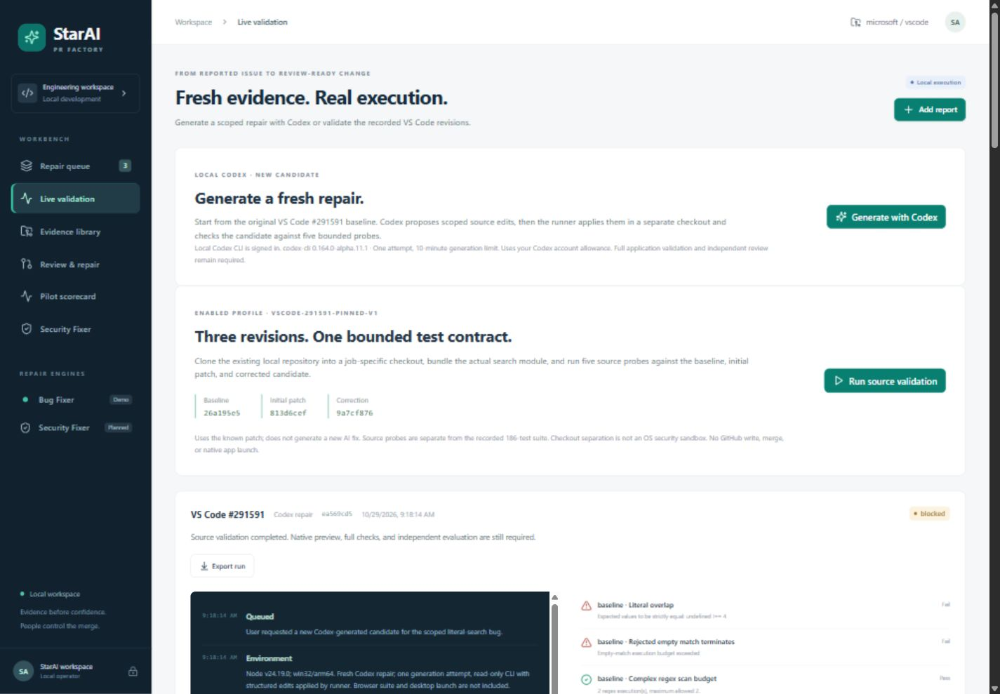

# StarAI PR Factory — implementation and acceptance record

October 29, 2026. Source specification: [PRD](StarAI-PR-Factory-PRD.md).

## Delivered locally

The app lives in `../pr-factory`. Start with `npm start` from that directory and open http://127.0.0.1:4173. React provides the workbench; a loopback Node server persists intake, jobs, checks, and events in SQLite. See [README](../pr-factory/README.md) for commands, API and boundaries.

The workbench includes all three recorded VS Code cases, reproduction steps and fixtures, original screenshots, historical repair replay, Copilot findings, the literal-search scope decision, diffs, evidence hashes, report exports, a review handoff, and a pilot scorecard. Security Fixer is clearly marked planned. Historical passes are labeled recorded; missing checks remain visible.

Two live profiles exist. Pinned validation re-executes the actual search module at the baseline, first patch and corrected candidate. Codex repair starts from the baseline, requests a fresh structured patch using the signed-in local CLI, validates the file scope and exact source matches, applies edits in the job checkout, runs source checks, and prepares a local draft package. Neither profile publishes or merges.

## Acceptance evidence

- Production build: TypeScript check and Vite build passed.
- Automated tests: eight passing tests cover API write protection, profile restrictions, exact-source patch validation, file-scope rejection, artifact integrity, verification gates, SQLite persistence, cancellation and process timeouts.
- Browser inspection: queue filters, case details, replay pause/resume/step/reset, diff switching, image evidence, report export and intake editing exercised. No fake intake submitted.
- Responsive checks: desktop 1440, tablet 768 and mobile 390 pixel widths; no horizontal overflow. Mobile navigation includes Security Fixer.
- Live pinned validation: two completed runs. Baseline 3/5 probes, initial patch 2/5, corrected candidate 5/5. The second run exercised pause and resume at a revision boundary.
- Recorded 186 upstream browser tests are historical evidence, not rerun or reassigned to a generated candidate.
- Live Codex repair `ea569cd5-297c-43b7-a319-051e42840ac8`: completed October 29 at 09:19 PDT. Baseline 3/5 source probes; newly generated candidate 5/5. A 6,500-byte patch changed three implementation files. The CLI trace reports 24,816 input tokens and 1,802 output tokens; no tool execution events appeared. Final status is blocked pending the missing assurance gates.

The generated patch is retained at `../pr-factory/.local/jobs/ea569cd5-297c-43b7-a319-051e42840ac8/candidate.patch`; its SHA-256 is `419c957f5b096089e65f2ccbc8a2a95edd40e4a71871a033b5b40a2fc91a6e92`. It is a fresh candidate, not a copy of the historical correction, and was not pushed to the existing PR. It has no new upstream regression-test file and needs broader review, including literal-search performance and Unicode behavior. The original VS Code checkout remained clean.

## Limits that prevent Verified status

The five fresh source probes do not establish a full application build, patched VS Code desktop behavior, complete upstream browser-suite coverage, GitHub CI, independent evaluation or isolated application preview. Generated edits require engineer review. Local checkout separation is not an OS security sandbox for untrusted repositories. Source validation therefore finishes blocked when its checks pass, and failed when they do not.

This delivers PRD Stage A and part of Stage B. Remaining Stage B work includes general issue ingestion and duplicate refresh, arbitrary repair planning, independent evaluation, a hardened execution service, application validation, and authorized idempotent PR publication. Stage C needs an actual advisory and agreed repository. Stage D needs tenant authentication, integration, retention and pilot measurement. No measured business outcomes or full-factory completion are claimed.

## Backend operation

Local Codex CLI `0.164.0-alpha.11.1` was discovered and reported signed in with ChatGPT. The app uses structured output, read-only execution and ephemeral sessions. A repair has one generation attempt, at most 10 minutes of generation and 30 minutes total. The fixed prompt includes only relevant public source and scoped issue behavior; arbitrary intake text is never executed. Only three existing search implementation files are eligible for structured edits.

Artifacts remain in `.local/jobs/<job-id>` with hashes in the job record. The local draft includes the exact baseline-plus-patch identity and missing gates. The prior draft PR #344811 is historical context, not the destination of automatic updates.

